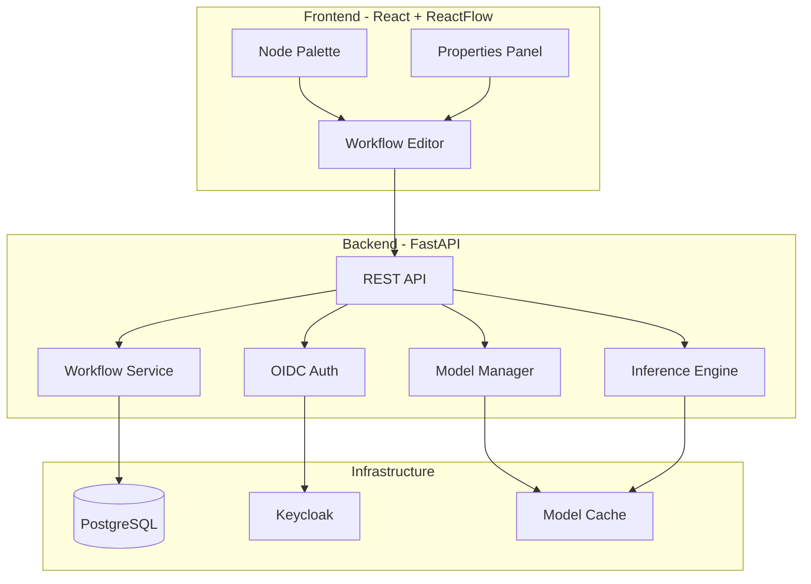

# Tensor Station

> Work in progress. This checkpoint may be incomplete or fail tests. See PLAN.md and STATUS.md before use.


**Ryan Vo | AI & Machine Learning**

Tensor Station is a node-based diffusion model orchestration platform with intelligent model caching, graph workflows, and fast local inference. It provides a visual graph editor for composing diffusion pipelines, a high-performance inference engine with VRAM-aware model management, and a REST API for programmatic access.

## Problem

Diffusion model workflows (ComfyUI, Stable Diffusion) suffer from:
- Repeated model loading on every prompt change
- Poor VRAM management causing OOM errors
- No visual pipeline composition
- Lack of programmatic API for automation

## Solution

Tensor Station implements:
- **Graph-based workflow editor** - Visual node canvas for composing diffusion pipelines
- **Intelligent model caching** - Models stay loaded in VRAM/RAM across executions
- **Fast inference engine** - Optimized sampling with multiple schedulers
- **REST API** - Programmatic workflow execution and model management
- **OIDC authentication** - Secure multi-user access via Keycloak

## Architecture



## Features

- **Visual Workflow Editor** - Drag-and-drop node graph with pan/zoom, mini-map
- **Model Management** - Register, load, unload, and cache diffusion models (checkpoints, LoRAs, VAEs, CLIP, ControlNet)
- **Inference Pipeline** - Queue executions, monitor progress, cancel runs
- **Multi-user Auth** - OIDC with Keycloak, role-based access (viewer/operator/admin)
- **LLM Integration** - Optional prompt enhancement via OpenAI/Anthropic/Gemini/Ollama

## Quick Start

### Prerequisites
- Docker and Docker Compose
- NVIDIA GPU with CUDA (for inference) or CPU fallback

### Development

```bash
# Clone and enter
cd tensor-station-ryan-vo

# Copy environment template
cp .env.example .env
# Edit .env with your settings

# Start all services
docker compose up -d

# Access:
# Frontend: http://localhost:3000
# Backend API: http://localhost:8000
# API Docs: http://localhost:8000/docs
# Keycloak: http://localhost:8080 (admin/changeme)
```

### Local Backend Development

```bash
cd backend
python3 -m venv .venv
source .venv/bin/activate
pip install -r requirements.txt
cp ../.env.example .env
uvicorn app.main:app --reload --host 127.0.0.1 --port 8000
```

### Local Frontend Development

```bash
cd frontend
npm install
npm run dev
```

## API Reference

### Health
- `GET /api/v1/health` - Service health check

### Workflows
- `POST /api/v1/workflows` - Create workflow
- `GET /api/v1/workflows` - List workflows (pagination)
- `GET /api/v1/workflows/{id}` - Get workflow
- `PATCH /api/v1/workflows/{id}` - Update workflow
- `DELETE /api/v1/workflows/{id}` - Delete workflow

### Models
- `POST /api/v1/models` - Register model
- `GET /api/v1/models` - List models (filter by type)
- `GET /api/v1/models/{id}` - Get model
- `POST /api/v1/models/load` - Load model to VRAM
- `POST /api/v1/models/{id}/unload` - Unload model
- `GET /api/v1/models/loaded/list` - List loaded models

### Inference
- `POST /api/v1/inference` - Queue inference
- `GET /api/v1/inference/{id}` - Get execution status
- `GET /api/v1/inference` - List executions
- `POST /api/v1/inference/{id}/cancel` - Cancel execution

## Configuration

| Variable | Description | Default |
|----------|-------------|---------|
| `DATABASE_URL` | PostgreSQL connection string | sqlite+aiosqlite:///./tensor_station.db |
| `SECRET_KEY` | JWT signing key | **Required** |
| `OIDC_ENABLED` | Enable OIDC auth | true |
| `OIDC_ISSUER_URL` | Keycloak realm URL | http://localhost:8080/realms/tensor-station |
| `OIDC_CLIENT_ID` | OIDC client ID | tensor-station-backend |
| `OIDC_CLIENT_SECRET` | OIDC client secret | **Required** |
| `LLM_API_KEY` | LLM provider API key | (optional) |
| `LLM_PROVIDER` | LLM provider type | openai-compatible |
| `LLM_MODEL` | LLM model name | gpt-4o-mini |
| `DEFAULT_DEVICE` | Inference device | cuda |
| `MAX_VRAM_USAGE_GB` | VRAM limit | 12.0 |

## LLM Providers

| Provider | Environment | Base URL |
|----------|-------------|----------|
| OpenAI-compatible | `LLM_PROVIDER=openai-compatible` | `LLM_BASE_URL` (optional) |
| Anthropic | `LLM_PROVIDER=anthropic` | `LLM_BASE_URL` (optional) |
| Gemini | `LLM_PROVIDER=gemini` | `LLM_BASE_URL` (optional) |
| Ollama | `LLM_PROVIDER=ollama` | `LLM_BASE_URL` (required) |

## Security Limitations

- Development mode uses self-signed certificates
- Demo credentials in `.env.example` must be changed for production
- TLS termination should be handled by reverse proxy (nginx/Traefik)
- Model files are not encrypted at rest

## SSO/SAML Setup

Keycloak supports SAML identity providers via identity brokering:

1. Access Keycloak Admin Console at `http://localhost:8080/admin`
2. Navigate to **Identity Providers** → **Add Provider** → **SAML v2.0**
3. Configure SAML settings from your IdP
4. Map attributes (email, name, roles) to Keycloak user attributes
5. Enable **First Login Flow** for automatic user provisioning

## AI/ML Evaluation

Tensor Station's core domain engine is the **diffusion model orchestration system** with:

- **Model caching benchmark**: Measure VRAM retention across prompt changes
- **Inference latency**: Time-to-first-image for various model sizes
- **Memory pressure handling**: Graceful offloading when VRAM exceeds threshold

Reproducible evaluation command (when implemented):
```bash
python -m benchmark.inference --model sdxl --steps 20 --runs 10
```

Baseline targets:
- Model switch latency: < 500ms (cached)
- Cold load: < 10s for SDXL
- VRAM utilization: > 85% of allocated

Failure cases:
- OOM on multi-GPU with dynamic VRAM (workaround: `--disable-dynamic-vram`)
- MPS float64 incompatibility (fixed: force float32 for rope)

## License

MIT License - Copyright (c) 2024 Ryan Vo <ryandtvo@gmail.com>